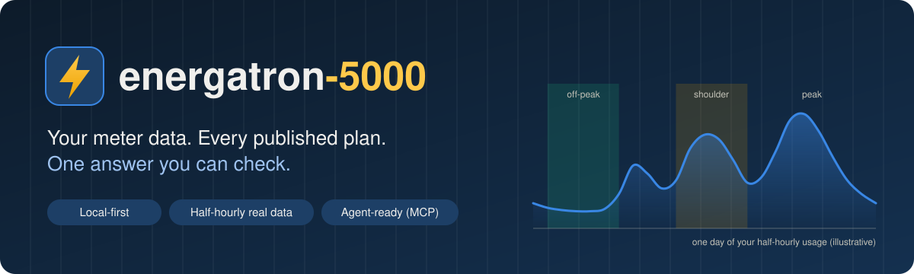
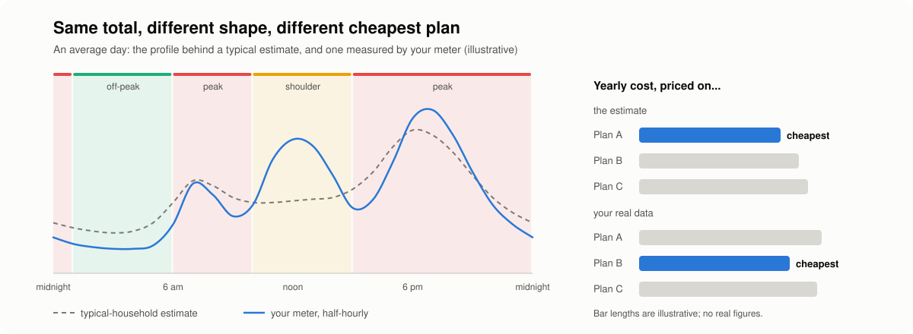
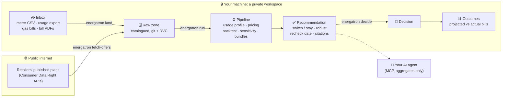
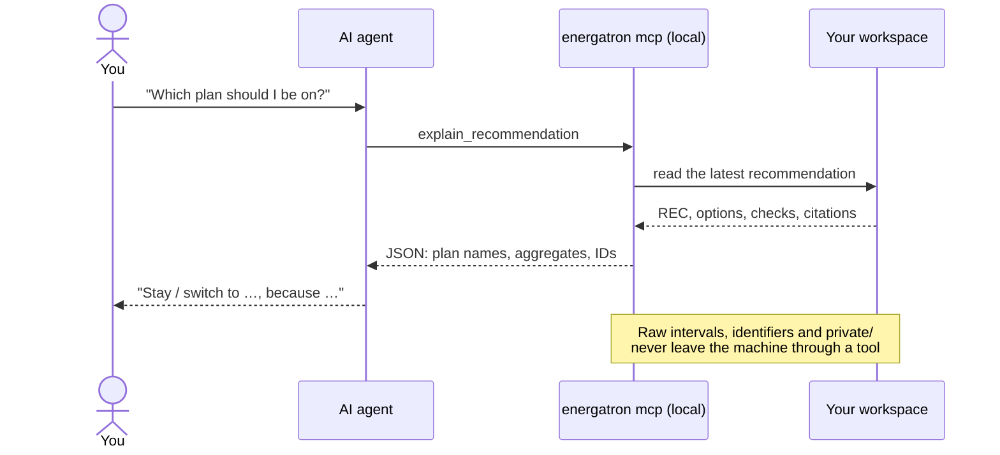

# energatron-5000

<p align="center">
  
</p>

<p align="center">
  <a href="https://github.com/demq/energatron-5000/actions/workflows/ci.yml"></a>
  
  
  
  
  <a href="LICENSE"></a>
</p>

<p align="center">
  <b>Find the energy plan that is actually cheapest for <i>your</i> home:<br>
  priced on your own half-hourly meter data and gas bills, against the retail plans published for your network,<br>
  checked against the bills you really paid, with your data never leaving your machine.</b>
</p>

<p align="center">
  <a href="#-try-it-in-two-minutes">Try the demo</a> ·
  <a href="#-use-it-with-an-ai-agent">Use it with an AI agent</a> ·
  <a href="#-how-it-compares">How it compares</a> ·
  <a href="#the-monthly-cycle-a-new-meter-download-to-a-recommendation">Manual</a>
</p>

---

## ⚡ Why

Retailer quotes and comparison sites price a plan for a *typical* household. But a time-of-use plan's cost depends
on **when** you use energy, not just how much: two homes with the same yearly total can have different cheapest plans.
Your smart meter already records every half hour, so there is no need to guess.

<p align="center">
  
</p>

energatron-5000 takes the data you can already download (your distributor's meter data, your retailer's usage export,
your gas bills), pulls the plans retailers publish for your network through the Consumer Data Right (CDR) APIs, prices each one
against your real usage, and recommends **switch** or **stay**, with the reasons and the evidence.

## ✨ What you get

<table>
<tr>
<td width="50%" valign="top">

**🔒 Your data stays local**<br>
Meter data, bills and results live in a private git + DVC workspace on your machine. The only data fetched from the
internet is public plan data, and your postcode only filters it locally. A pre-commit privacy guard blocks your
identifiers from being committed.

</td>
<td width="50%" valign="top">

**📈 Priced on what you really use**<br>
Every half-hour interval is priced against the plan's own tariff windows, supply charges, discounts and fees, for
electricity and gas, as separate plans and as dual-fuel bundles.

</td>
</tr>
<tr>
<td valign="top">

**🧾 Checked against your real bills**<br>
The backtest re-bills your past billing periods with the plan you were on and compares the result to the invoices you
actually paid, so you can see the engine is right before you trust it.

</td>
<td valign="top">

**🧪 Robust, not just cheapest**<br>
Sensitivity checks rerun the ranking with more usage, less usage, the previous year's usage, and conditional discounts missed.
The recommendation says whether it holds up (`robust`) and when to check again.

</td>
</tr>
<tr>
<td valign="top">

**🔁 Keeps watching**<br>
A weekly check fetches new plans, reruns what changed and sends a macOS notification when a cheaper plan appears.
Record your switch and later bills are tracked against what was projected.

</td>
<td valign="top">

**🤖 Built for AI agents**<br>
A local MCP server and ready-made skills let Claude Code, Codex or any MCP client land files, run the pipeline and
explain the result in plain language, on top of commands that all speak `--json`.

</td>
</tr>
<tr>
<td valign="top">

**🔍 Every number is traceable**<br>
Each recommendation cites the datasets, plan snapshots and parameters behind it, and its run commit is recorded.
`energatron verify` reruns everything from the committed inputs and fails if any result doesn't reproduce byte for byte.

</td>
<td valign="top">

**🖥️ Terminal, browser or agent**<br>
HTML reports for the recommendation and your usage, a read-only local web UI (`energatron serve`), and the same answers
as JSON for scripts.

</td>
</tr>
</table>

## 🆚 How it compares

[Energy Made Easy](https://www.energymadeeasy.gov.au/) (EME), the Australian Energy Regulator's free comparison site,
is a good first stop: it is quick, covers Australia, and retailers must give it every generally available plan.
energatron-5000 goes deeper for one household that is willing to do a little setup.

| | Retailer quote | Energy Made Easy | **energatron-5000** |
|---|:---:|:---:|:---:|
| Electricity usage it prices | typical or average usage | your last 12 months of meter data via your NMI (only if you've been at the property 12 months), else benchmarks | **your half-hourly data: the latest 12 months to rank, the year before as a check, all of it for backtests** |
| Gas usage | typical or average usage | typed in by hand | **transcribed from your bills, each checked against its own reads and charges** |
| Checks its maths against bills you paid | ✗ | ✗ | **✓ backtest per billing period** |
| Saving against your current plan | ✗ | ✗ (it says it can't tell you) | **✓ ongoing and first year, once you name your plan** |
| Robustness checks | ✗ | ✗ | **✓ usage ±, previous year, discounts missed** |
| Re-checks for you | ✗ | on demand | **✓ weekly, with notifications** |
| Precision | – | rounded to the nearest ten dollars | **to the cent, every figure cited and reproducible** |
| Where your usage data goes | the retailer | the EME site (via AEMO) | **nowhere: it stays on your machine**¹ |
| AI agent access | ✗ | ✗ (no API) | **✓ MCP server and skills** |
| Regions | one retailer's | Australia | Australia: the South Australia profile ships today ([add your region](CONTRIBUTING.md)) |
| Solar feed-in | varies | ✓ | not priced yet |
| Effort | none | minutes | a setup, then a download a month |

**In short:** use EME for a quick look. Use energatron-5000 when you want an answer priced on
everything your meter recorded, checked against the bills you actually paid, kept current every week, and kept private.

¹ Unless you use an AI agent: then the aggregates its tools return go to your model provider (see [below](#-use-it-with-an-ai-agent)).

EME details are from its own [plan search guide](https://www.energymadeeasy.gov.au/article/how-the-energy-made-easy-plan-search-works)
and [FAQ](https://www.energymadeeasy.gov.au/frequently-asked-questions), as of November 2026.

## 🧭 How it works



Every step is a git commit in your workspace, so you can see exactly what changed and when. The pipeline reruns only the stages whose inputs changed.

## 🚀 Try it in two minutes

You need [uv](https://docs.astral.sh/uv/) and git. uv fetches Python 3.14 and everything else into the workspace's own
virtual environment; nothing is installed globally.

```bash
curl -LsSf https://astral.sh/uv/install.sh | sh        # only if you don't have uv yet
uvx --from git+https://github.com/demq/energatron-5000 energatron init --demo ~/energatron-demo
cd ~/energatron-demo
uv run energatron status
open data/reports/recommendations/index.html data/reports/usage/index.html
```

`init --demo` creates a workspace, fills it with synthetic data (fourteen months of half-hourly meter readings, a
retailer usage export, twelve gas bills and a frozen set of made-up offers), lands it, and runs the whole pipeline to a
recommendation. Every number in it is invented. The demo workspace is a normal one: try `uv run energatron serve --open`
to browse it, or `uv run energatron verify` and `uv run energatron diagnose`.

## 🤖 Use it with an AI agent

energatron-5000 is designed to be driven by an AI agent. The agent runs the commands, reads the JSON and explains the
result in plain language, while the tool does the arithmetic, the checks and the bookkeeping. That keeps the numbers
deterministic and reproducible however the agent phrases things.

**1. Make a workspace** (the demo above, or [your own](#-your-own-workspace)).

**2. Open your agent in it.** Every workspace comes with a `.mcp.json` that registers the local MCP server, plus
agent instructions (`CLAUDE.md`, `AGENTS.md`) and skills.

```bash
cd ~/energatron-demo
claude                                   # Claude Code: approve the energatron server when asked
codex mcp add energatron -- uv run --directory ~/energatron-demo --frozen energatron mcp   # Codex
```

Any other MCP client: run `uv run energatron mcp` in the workspace as a stdio server.

**3. Ask.** For example:

> *"Do my monthly check-in: land whatever is in the inbox, fetch new offers and run the pipeline."*
>
> *"Which electricity plan is cheapest for me, and how sure are you? Explain the recommendation."*
>
> *"How has my usage changed over the last 13 months, and how much of it falls in the peak window?"*
>
> *"Compare the top five gas plans, and tell me what changed in the offers since last month."*
>
> *"I've signed up to the recommended plans from the first of next month. Record the decision as a dry run."*

The workspace skills cover the routine jobs: **monthly check-in**, **explain a recommendation**, **record a
decision** and **transcribe a gas bill**.



**What the agent can and can't see.** Tools return aggregates, IDs, plan names and statuses: your usage and cost
figures, but never `private/`, your identifiers or interval rows. Whatever a tool returns goes to your model provider,
so that is the boundary. Nothing that backs up, deletes, installs or rewrites config is exposed as a tool; those stay
yours. Full details in [Agents](#agents).

## 🏠 Your own workspace

```bash
uvx --from git+https://github.com/demq/energatron-5000 energatron init ~/energy --remote ~/Backups/energy-dvc
cd ~/energy
uv run energatron status
```

`init` asks for your NMI and meter serial (both are in the name and header of your SA Power Networks meter-data
download) and your postcode, and keeps them in `private/config.toml`, which DVC tracks and git never sees. They feed
the privacy guard, a pre-commit hook that blocks any commit holding them. `--remote` is a local folder for the DVC
backup of your data (an external disk, or a cloud-synced folder); leave it out and add one later with `uv run dvc
remote add --local -d backup <folder>`. The workspace depends on the exact tool commit `init` ran from, so it doesn't
change under you (see [After a tool update](#after-a-tool-update)). Then follow [the monthly
cycle](#the-monthly-cycle-a-new-meter-download-to-a-recommendation), or ask your agent to.

## 🗺️ Where it works

- **Region:** South Australia (SA Power Networks electricity and the Adelaide gas network). Other regions come by
  contribution: a region is mostly a profile of its network's tariff windows and retailers (see `CONTRIBUTING.md`).
- **Platform:** macOS. Linux should work, but the weekly schedule and notifications are macOS-only.
- **Fuels:** electricity (flat, time-of-use and demand tariffs) and gas, separately and as bundles.
- **Built so far:** landing and cataloguing, the meter pipeline, the usage profile, offers and the electricity and gas
  engines, bundles, recommendations, decisions, the weekly watch, `init` with a synthetic demo, the MCP server and the
  local web UI. See [`CHANGELOG.md`](CHANGELOG.md).

---

# 📖 Manual


## Privacy model

- This repo holds code and design docs only, never personal data.
- Real data lives in a separate, private workspace repo that the tool reads; the workspace is never published.
- Identifiers (meter numbers, account numbers, addresses) and usage or cost figures never enter this repo.
- A pre-commit privacy guard and CI reject commits that contain them, or data files outside `tests/fixtures/`.
- Test fixtures are synthetic and generated by code, never derived from real files.

## How it fits together

```
~/WorkSpace/Electricity/
├── energatron-5000/    this repo: the tool (code, design docs)
└── demq-elektric/      your workspace: config, DVC pointers and data, private, never on a public host
```

- The workspace is a git repo whose data is managed by [DVC](https://dvc.org) and backed up to a folder you choose
  (the owner's: iCloud Drive).
- Files you download go into the workspace's inbox, `data/landing/`. `energatron land` copies each one into the
  raw zone (`data/raw/`) with an ID, a catalog record and a commit.
- `energatron run` runs the pipeline (twenty stages: meter data, usage profile, offers, costs, backtests,
  sensitivity, bundles, recommendation, outcomes), records the run in `data/runs/` and commits.
- The recommendation (`REC-…`) is at `data/reports/recommendations/` as JSON and an HTML page.
- Every command takes `--json` (one JSON document on stdout) and returns an error code from `core/errors.py`.

## The owner's workspace

<details>
<summary>How the original, hand-built workspace differs (only relevant to it)</summary>

The tool started as one household's, whose workspace was set up by hand before `init` existed (the P0 spec,
`agent_docs/2026-10/2026-10-23_p0-bootstrap-spec.md` §11). It sits next to this repo, as in the tree above, and depends
on it as an editable install; its backups go to iCloud Drive through `scripts/icloud_backup.py`. Everything below works
the same in a workspace `init` made. After changing the private config, write the pipeline files and the redaction
denylist, then commit what they list:

```bash
cd ~/WorkSpace/Electricity/demq-elektric
uv run energatron pipeline sync
uv run energatron denylist
uv run energatron status
```

</details>

Every command below runs from the workspace folder.

## The monthly cycle: a new meter download to a recommendation

1. **Download** the detailed interval data (NEM12 CSV) for your NMI from the SA Power Networks customer portal, and
   move the file into `data/landing/`. Leave its name as downloaded.
2. **Land** it. Try a dry run first; it says what would land and why anything is rejected:

```bash
uv run energatron land data/landing/ --dry-run
uv run energatron land data/landing/
```

   `land` makes its own commit (`land: <ids>`). Landing the same bytes again is a no-op. Retailer usage exports,
   transaction CSVs and bill PDFs land the same way, all in one command: a bill is recognised (electricity or gas) and
   dated by the issue date printed on it. Only if `land` says it can't tell (`E_AMBIGUOUS_SOURCE`, e.g. a dual-fuel
   bill) name the source: `uv run energatron land data/landing/<bill>.pdf --source elec_bill`.
3. **Run** the pipeline. It refuses to start with uncommitted config or tool changes; commit them first:

```bash
uv run energatron run
```

   The first run after a tool update reruns every stage (a few minutes); later runs rerun only what changed. While it
   works, `run` prints each step and each stage as it starts and ends (with its time) on stderr; add `-v` to also see
   DVC's own output.
4. **Read** the result: open `data/reports/recommendations/index.html` (the recommendation, its options, the
   sensitivity checks and what it cites) and `data/reports/usage/index.html` (the usage report) in a browser.
5. **Check** where things stand, and clear the inbox of what has landed:

```bash
uv run energatron status
uv run energatron landing list
uv run energatron landing clear --dry-run
uv run energatron landing clear
```

   `landing clear` deletes only inbox files whose exact bytes are already in the raw zone, and asks first.
6. **Back up** (in your own terminal, which can reach iCloud Drive): see [Backups](#backups-and-the-restore-drill).

## Gas bills

```bash
uv run energatron land data/landing/<bill>.pdf
uv run energatron gas-bill new <gas_bill dataset ID> --extracted-by manual
# fill in data/landing/gas_bill_record-<ID>.yaml from the bill, following its comments
uv run energatron gas-bill check data/landing/gas_bill_record-<ID>.yaml
uv run energatron land data/landing/gas_bill_record-<ID>.yaml --dry-run
uv run energatron land data/landing/gas_bill_record-<ID>.yaml
uv run energatron run
```

The record holds no account, MIRN or invoice number. If a `gas_bills` check fails, the transcription is wrong: fix
the YAML and land the corrected copy (the newest record for a bill wins). `gas-bill check` runs those checks before you land it.
An agent fills the same record with `extracted_by: agent:<model id>`; `gas-bill write` writes a record only when
every check passes, so the checks, not the agent, decide what lands.

## Offers

```bash
uv run energatron fetch-offers --dry-run
uv run energatron fetch-offers
uv run energatron offers diff
uv run energatron run
```

`fetch-offers` lists every configured retailer's plans from the Consumer Data Right (CDR) APIs, keeps the ones for
your distributor (and postcode, from the private config), and lands only plans that changed, in one commit.
`offers diff` shows what changed between each plan's two newest snapshots (`--plan <plan ID>` for one plan).

## Deciding and switching

The recommendation says `switch` or `stay`, whether that holds under the sensitivity checks (`robust`), and a date to
check again (`recheck_by`). Switching is your call. To record it against the current recommendation:

```bash
uv run energatron decide <REC-id> --switch-date <YYYY-MM-DD> --elec <offer snapshot ID> --gas <offer snapshot ID> --dry-run
uv run energatron decide <REC-id> --switch-date <YYYY-MM-DD> --elec <offer snapshot ID> --gas <offer snapshot ID>
```

The snapshot IDs come from the recommendation's options. `--evidence <dataset ID>` links a landed document (a fact
sheet, a welcome letter). After the switch, set `current_plans` in `private/config.toml`, and add the new plans to
`backtest.tariffs` / `backtest.gas_tariffs` in `params.yaml` from the switch date. Later bills then show up in the
outcomes report (`data/reports/outcomes/`) against what was projected.

## The weekly check

`energatron watch` fetches offers, runs the pipeline when something new landed (every fetch lands a new fetch log, so
usually it runs), compares the new recommendation with the one before and says whether a cheaper plan appeared:

```bash
uv run energatron watch --dry-run
uv run energatron watch
uv run energatron watch --notify
```

`--notify` shows macOS notifications: **cheaper plan** (a different plan now tops a `switch` recommendation; plan names
and the REC ID only, never figures), **weekly check failed** (the fetch or the run failed; run `status`), and
**reminders** (backup pending, restore drill due, recheck due, new files in the inbox). A failed fetch or run exits
with `E_PARTIAL` (exit 8).

To run it every week, install a launchd agent for your user (optional; Monday 09:00 unless you choose otherwise):

```bash
uv run energatron schedule install --dry-run
uv run energatron schedule install --weekday 1 --hour 9
uv run energatron schedule status
uv run energatron schedule remove
```

The agent runs `uv run --frozen energatron watch --notify --json` in the workspace and writes its output to
`.energatron/logs/watch.log` (git-ignored). A Mac that was asleep runs a missed check when it wakes. The weekly run
commits like a manual one, so it needs a clean workspace: uncommitted config or tool changes make it fail and notify.

## Backups and the restore drill

In a workspace `init --remote` made, `uv run energatron backup` pushes the DVC data to that folder and writes a verified
git bundle beside it (`backup --status` says whether one is pending). Back the folder up off the machine as you see fit.

The owner's workspace backs up to iCloud Drive. Agents and the tool never touch iCloud themselves; the owner runs the
backup from a terminal that can reach iCloud Drive, following `agent_docs/2026-10/2026-10-23_icloud-backup-runbook.md`:

```bash
cd ~/WorkSpace/Electricity
uv run energatron-5000/scripts/icloud_backup.py backup
uv run energatron-5000/scripts/icloud_backup.py backup --drill
```

`backup` pushes DVC data and writes a verified git bundle. Run it after commits (`status` says when one is pending).
`backup --drill` also runs the **restore drill**: a scratch clone from the newest bundle and the DVC remote, checked
end to end with `energatron verify`. Do it quarterly. The drill rebuilds the tool by cloning it from GitHub at the
commit your last run used, so **push the tool repo first** (`status` warns `W_TOOL_UNPUBLISHED` until you do):

```bash
git -C ~/WorkSpace/Electricity/energatron-5000 push
```
 A passed drill is recorded in `.energatron/drill_state.json`, and
`status` warns `W_DRILL_DUE` after 91 days. To check the backup state from the workspace:

```bash
uv run energatron backup --status
uv run energatron verify
```

`verify` re-hashes every landed file and reruns every stage from the committed inputs; it fails if anything doesn't
reproduce byte for byte.

## After a tool update

To move a workspace `init` made to a newer tool, change the `rev` (or the path) of `energatron-5000` in its
`pyproject.toml`, run `uv sync`, and commit `pyproject.toml` and `uv.lock`. Then:

```bash
uv run energatron upgrade --dry-run
uv run energatron upgrade
uv run energatron migrate --dry-run
uv run energatron migrate
uv run energatron pipeline sync
uv run energatron run
```

- `upgrade` refreshes the files the template manages (the hooks, their scripts, `.gitignore`), leaves any you edited
  alone (`W_TEMPLATE_MODIFIED`; `--force` replaces them), and commits. A hand-built workspace is upgraded by hand.
- `migrate` rewrites config files an older version wrote (`workspace.toml`, `private/config.toml`, local rules) to the
  current schema and commits them. Comments in those files are lost, so read the dry run first.
- `pipeline sync` regenerates `dvc.yaml`, `params.yaml` and new empty catalogs; commit the files it lists (they are
  config), then run. `energatron status` shows whether the pipeline is in sync and which stages' code changed.

## Getting help without sharing data

```bash
uv run energatron diagnose --redacted
uv run energatron diagnose --json
```

`diagnose` reports versions, the workspace's structure (config kinds and versions, catalog counts, stage names) and
which checks fail, by error code. It never holds a file name, an identifier, a plan or a figure. Read it, then paste the
JSON into a GitHub issue. Never attach your own data files to an issue.

## Reminders and troubleshooting

`energatron status` lists reminders as warnings:

| Reminder | Meaning | Do |
|---|---|---|
| `W_LANDING_NEW` | files in `data/landing/` not landed yet | `land data/landing/` (dry run first) |
| `W_RUN_BEHIND` | the last clean run predates the data, the config or the code | `run` (after `pipeline sync` if not in sync) |
| `W_OFFERS_STALE` | no offers fetched for over two weeks | `fetch-offers`, or schedule `watch` |
| `W_RECHECK_DUE` | the recommendation's recheck date has come | `fetch-offers`, then `run` |
| `W_BACKUP_PENDING` | commits not in a backup yet | `icloud_backup.py backup` |
| `W_DRILL_DUE` | no restore drill in 91 days | `icloud_backup.py backup --drill` |
| `W_TOOL_UNPUBLISHED` | the tool commit the last run used isn't on GitHub (as of the last fetch) | push the tool repo before a drill |
| `W_LANDING_LANDED` | inbox files already landed | `landing clear` |

Errors a cycle can meet:

| Code (exit) | Meaning | Do |
|---|---|---|
| `E_PIPELINE_NOT_SYNCED` (4) | the pipeline files don't match the tool | `pipeline sync`, commit, rerun |
| `E_DIRTY` (4) | uncommitted config, or the tool checkout has changes | commit them (or `run --draft` for a look; a draft can't be decided on) |
| `E_LOCKED` (4) | another energatron command holds the workspace | wait for it, then rerun |
| `E_CHECK_FAILED` (7) | a stage's quality check failed | read the stage's report; it is a real finding, not a glitch |
| `E_PARTIAL` (8) | some items failed (a file, a retailer, a step of `watch`) | the result lists which |
| `E_NETWORK` (6) | the CDR APIs couldn't be reached | rerun later |
| `E_FOREIGN_PREMISES` (5) | a file belongs to another meter or account | it isn't yours; don't land it |
| `E_DENYLIST_STALE` (4) | the private config changed since the denylist | `denylist`, commit `private.dvc` |

Add `-v` (progress) or `--debug` (with tracebacks) to any command.

## Web UI

Look at a workspace in a browser instead of the terminal:

```bash
uv run energatron serve --open
uv run energatron serve --port 0
```

It prints an address such as `http://127.0.0.1:8765/?token=…` and serves until Ctrl-C. Open that address (`--open`
does it for you); the token in it signs this browser in for the session, and a new one is made at every start. The pages
show where things stand, the recommendation and the plans ranked behind it, usage, datasets, offer changes, the inbox,
the workspace's health, a gas bill record check, and the pipeline's usage and recommendation reports. Every section links
to its JSON: `GET /api/v1/<read>` answers exactly what `energatron <command> --json` prints (`/api/v1` lists them;
scripts send `Authorization: Bearer <token>`).

- It is read-only: nothing is written, landed, run or committed from the browser, and it takes no lock, so it can stay
  open while you run commands. Reload a page to see what changed.
- It listens on this machine only (`--host` takes `127.0.0.1`, `localhost` or `::1`), and refuses requests without the
  token or from other sites. Nothing leaves the machine.
- `--allow-documents` also serves a landed gas bill's text (`/gas-bill/text/<dataset id>`), personal details included.
- The port is taken: pick another with `--port`, or `--port 0` for any free one.
- `serve` says `web_dependencies_missing` in a workspace made before this version: run `uv lock` and `uv sync` there,
  then commit `uv.lock`. Every other command works without them.

## Agents

Claude Code and Codex read the same instructions (`CLAUDE.md`, with `AGENTS.md` linked to it) and skills. A workspace
made by `energatron init` has skills for a monthly check-in, explaining a recommendation, recording a decision and
transcribing a gas bill (`.claude/skills/`, linked from `.agents/skills/`), and `.mcp.json`, which registers a local MCP
server:

```bash
uv run energatron mcp
uv run energatron mcp --allow-documents
```

It speaks MCP on stdio and offers tools that each run one command and return its `--json` envelope: `status`,
`list_datasets`, `list_inbox`, `usage_summary`, `compare_offers`, `explain_recommendation`, `offers_diff`,
`land_file` (only from `data/landing/`), `fetch_offers`, `run_pipeline`, `record_decision` (a dry run unless told
otherwise), and the gas bill record tools. The same answers come from the command line:

```bash
uv run energatron datasets --limit 20
uv run energatron usage --months 13
uv run energatron compare --fuel electricity --limit 10
uv run energatron explain
```

- **Claude Code** reads the workspace's `.mcp.json` and asks you to approve the server the first time. **Codex**:
  `codex mcp add energatron -- uv run --directory <workspace> --frozen energatron mcp`. Any other MCP client: run
  `uv run energatron mcp` in the workspace.
- Whatever a tool returns goes to the model provider. Tools return aggregates, IDs, plan names and statuses: your usage
  and cost figures, never `private/`, identifiers or interval rows. `--allow-documents` adds `read_gas_bill_text`,
  which sends a bill's text (address and account included) for transcription; leave it off unless you want that.
- No tool backs up, clears the inbox, installs the weekly agent, upgrades or rewrites config: those stay yours.
  `run_pipeline` can take minutes; raise your client's tool timeout if it gives up first.

Development work in this repo runs through `TASKS.md` (`/next`, `/examine`, `/done`, or `/phase`).

## Development

Python 3.14, managed by [uv](https://docs.astral.sh/uv/). No pip, conda or global installs.

```bash
uv sync
uv run ruff check
uv run ruff format --check
uv run pyright
uv run lint-imports
uv run pytest -q
uv run pre-commit run --files <changed files>
```

Design docs are in `agent_docs/`: the plan, the core architecture spec (binding for all code) and one spec per phase.
`CONTRIBUTING.md` says how to contribute, including adding a region; `SECURITY.md` how to report a vulnerability.

## Licence

Apache-2.0; see `LICENSE` and `NOTICE`.
